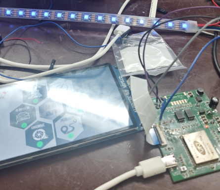
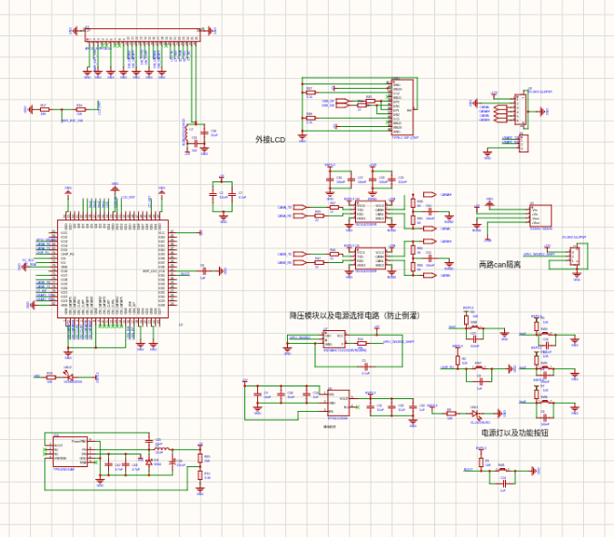
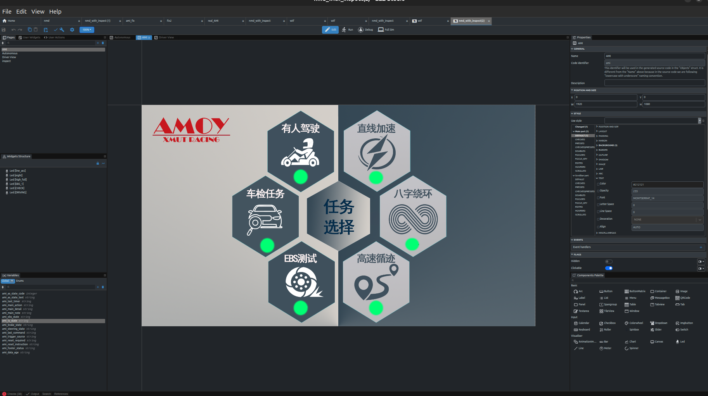
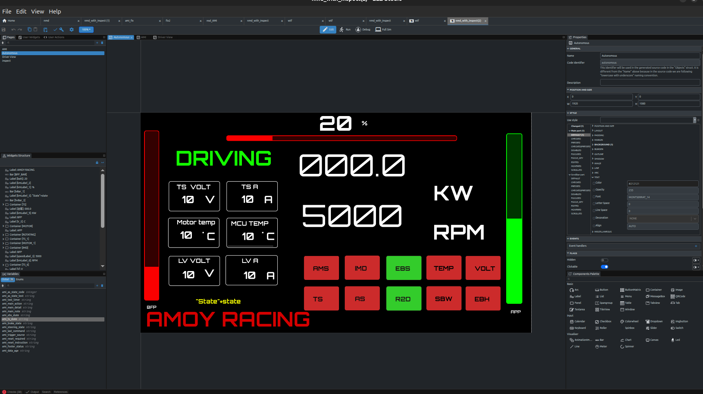
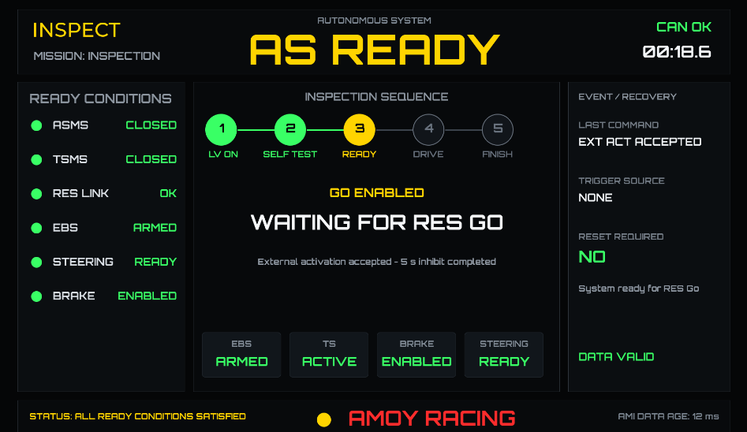

# AMOY 大学生无人方程式 AMI 实现方案

本工程基于正点原子 ESP32-P4 开发板，实现无人方程式赛车的 AMI（Autonomous Mission Indicator）图形界面。系统使用 EEZ Studio 设计页面，以 LVGL 8 渲染，通过独立按键选择任务，并使用 ESP32-P4 的 TWAI 控制器接入 CAN 总线。当前代码可演示任务选择、页面跳转和 CAN 收帧提示；车辆状态及任务执行逻辑仍需与整车控制系统对接。




## 硬件与芯片

| 器件 / 接口 | 工程中的作用 |
| --- | --- |
| ESP32-P4 | 主控，运行 ESP-IDF、FreeRTOS、LVGL 和 TWAI 驱动 |
| RGB LCD 或 MIPI DSI LCD | 显示 AMI 页面；BSP 根据屏幕连接情况初始化，检测到 RGB 屏时优先使用 RGB 屏 |
| GT9xxx 系列触摸控制器 | 通过 I²C 提供触摸输入；驱动支持 GT911、GT9147、GT9271 等型号，具体型号取决于所接屏幕 |
| 外部 CAN 收发器 | 连接 ESP32-P4 的 TWAI TX/RX 与车辆 CAN 总线；主控不能直接连接 CAN_H/CAN_L |
| PSRAM 与 16 MB Flash | 存放全屏绘图缓冲区、UI 资源和固件；当前配置已启用 PSRAM，并配置 16 MB Flash |

当前应用的主要引脚：

| 功能 | 引脚 | 说明 |
| --- | --- | --- |
| 任务选择按键 | GPIO36 | 低电平有效，使用内部上拉；与 XL9555 的 KEY1 不同 |
| TWAI TX / RX | GPIO23 / GPIO51 | 需连接外部 CAN 收发器 |
| LCD 背光 / 复位 | GPIO53 / GPIO52 | 由 LCD BSP 管理 |
| 蜂鸣器 | XL9555 EXIO0 | 低电平有效 |

硬件接线请结合开发板原理图及 [硬件参考手册](docs/DNESP32P4硬件参考手册_V1.0.pdf) 核对。

硬件原理图：


## 功能与操作

开机进入 **AMI** 页面，默认选中 `MANUAL DRIVING`。选中项的指示灯为红色，其余为绿色。GPIO36 按键的操作如下：

| 操作 | 行为 |
| --- | --- |
| 在 AMI 页面短按 | 按 `MANUAL DRIVING → ACCELERATION → SKIDPAD → TRACKDRIVE → EBS TEST → INSPECTION` 顺序循环选择 |
| 在 AMI 页面长按约 800 ms | 确认当前任务；前五项进入 `Autonomous` 页面并更新任务名称，`INSPECTION` 进入 `Inspect` 页面 |
| 在任务页面长按约 800 ms | 返回 AMI 页面 |

TWAI 工作在正常模式，波特率为 **250 kbit/s**，接收过滤器允许所有帧。收到任意一帧后，程序会通过 XL9555 打开蜂鸣器并保持鸣响，直至复位或断电。当前回调仅把收帧作为总线通信提示，**尚未解析 CAN 数据，也不会据此更新车速、任务状态或检查页数据**。`Inspect` 页的部分文字来自 `main/ui_compat.c` 中的默认值；该页目前是界面展示与后续数据对接入口。

## 工程结构

```text
.
├── CMakeLists.txt                # ESP-IDF 工程入口
├── sdkconfig                     # 芯片、Flash、PSRAM、LVGL 等配置
├── partitions.csv                # 16 MB Flash 分区表
├── main/
│   ├── main.c                    # AMI 任务选择、按键、CAN 回调和程序入口
│   ├── APP/lvgl_demo.c           # LVGL 显示、触摸适配与刷新任务
│   ├── BSP/bsp_can.c             # TWAI 初始化、接收任务与发送接口
│   ├── ui/                       # EEZ Studio 导出的页面、字体和图片
│   ├── ui_compat.c               # EEZ 原生变量的默认值和设置接口
│   └── idf_component.yml        # LVGL 组件依赖
├── components/BSP/              # LCD、触摸、I²C、XL9555 等板级驱动
├── wtf.eez-project              # EEZ Studio 界面工程
└── docs/                        # 硬件参考资料
```


## 关键配置

| 配置项 | 当前值 / 位置 |
| --- | --- |
| 目标芯片 | `esp32p4`，见 `sdkconfig` |
| ESP-IDF | `dependencies.lock` 记录为 6.0.2；建议使用相同版本复现构建 |
| LVGL | `main/idf_component.yml` 要求 `^8.3.11`，锁定版本为 8.4.0 |
| Flash / 分区 | 16 MB；`partitions.csv` 中应用分区为 14 MB |
| PSRAM / 色深 | 已启用 PSRAM；LVGL 色深为 32 bit |
| CAN 引脚、诊断模式 | `main/main.c` 中的 `CAN_TX_PIN`、`CAN_RX_PIN`、`CAN_DIAGNOSTIC_MODE` |
| CAN 速率、过滤器 | `main/BSP/bsp_can.c` 中的 TWAI 配置 |

将 `CAN_DIAGNOSTIC_MODE` 改为 `1` 可编译 CAN 联调版本：程序跳过 LCD、触摸和 LVGL 初始化，收到 CAN 帧后仍通过蜂鸣器提示。默认值为 `0`。

## 编译与烧录

安装支持 ESP32-P4 的 ESP-IDF，并加载环境后，在项目根目录执行：

```bash
. /path/to/esp-idf/export.sh
idf.py set-target esp32p4
idf.py build
idf.py -p /dev/ttyUSB0 flash monitor
```

将 `/dev/ttyUSB0` 换成实际串口。`idf.py set-target` 会重新生成目标相关配置，首次使用时请核对 16 MB Flash、PSRAM 和自定义分区表是否仍与本工程一致。退出串口监视器可按 `Ctrl+]`。

## 方案特点与适用范围

- **界面与硬件分层**：EEZ 导出的页面位于 `main/ui/`，LCD、触摸和扩展 I/O 位于 `components/BSP/`，任务选择及 CAN 逻辑集中在 `main/`，便于分别维护。
- **支持两类显示接口**：BSP 包含 RGB 和 MIPI DSI 屏驱动；竖屏 MIPI 面板通过软件旋转适配横屏 UI，并同步转换触摸坐标。
- **具备联调入口**：250 kbit/s CAN 收帧可用蜂鸣器直接确认，诊断模式可在不初始化显示系统时检查总线连接。
- **便于扩展整车数据**：`main/ui_compat.c` 提供检查页变量的设置入口，后续可接入实际 CAN 协议解析和状态机。

当前 1920 × 1080 UI 使用全屏绘图缓冲区和旋转缓冲区，对 PSRAM 容量有要求。项目目前属于 AMI 界面与通信联调实现；任务状态、检查页数据和车辆控制功能需按实际赛车协议继续开发与验证。

##  界面实现



基于eez_studio实现，设计好界面之后可以直接指定路径生成标准的.c.h文件，极大的方便了开发


--任务驾驶界面：



--车检界面设计：


